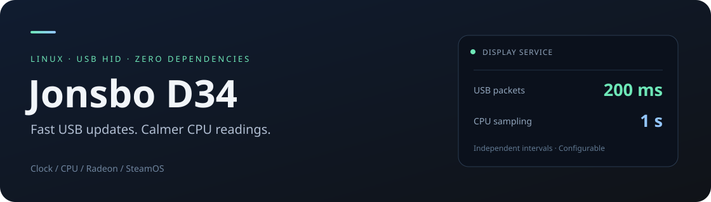

<p align="center">
  
</p>

<p align="center">
  <a href="LICENSE"></a>
  
  
  
</p>

# Jonsbo D34 · Linux

A small background service for the **Jonsbo D34 front status panel**. Sends local
time, CPU/GPU temperatures and CPU frequency directly over USB HID, using only
the Python standard library. Runs as your desktop user, including SteamOS Gaming Mode.

[Русская инструкция](docs/README.ru.md) · [Protocol](docs/protocol.md) ·
[Troubleshooting](docs/troubleshooting.md) · [Contributing](CONTRIBUTING.md)

## Why two update intervals?

The panel needs frequent USB packets: sending once per second caused visible
blinking on the tested unit. The service sends a packet every **200 ms**, but reads
CPU frequency only **once per second**, repeating that value between measurements.
This keeps the display fed without making the frequency digits change five times a second.

- Local clock and date; CPU temperature and mean current CPU frequency.
- Discrete Radeon temperature, with GPU usage, power and clock where available.
- CPU and RAM usage; fields actually shown depend on the panel firmware.
- Automatic device rediscovery after disconnects or temporary permission errors.
- A user systemd service, journal logging and single-instance locking.
- No vendor application, `pip` packages or kernel modules needed at runtime.

## Tested setup

| Component | Tested hardware / software |
| --- | --- |
| Case / panel | Jonsbo D34, USB HID `5131:2007`, 64-byte output report |
| OS | SteamOS 3.8.16, Linux 6.16.12 (Valve Neptune), Python 3.13.5 |
| CPU | AMD Ryzen 7 9800X3D, `k10temp` / `Tctl` |
| GPU | AMD Radeon RX 9070 XT, 16 GiB, `amdgpu` / `edge` |
| Motherboard | ASRock B850M Steel Legend WiFi |

The integrated Radeon is also present; the service selects the AMD GPU with the
largest VRAM capacity. Hardware validation is limited to this setup. Intel CPU
and NVIDIA GPU sensor backends are **not implemented**. Other devices sharing the
same USB ID are not automatically compatible; the HID descriptor is checked before writing.

## Quick start

Requirements: Linux, **Python 3.10+**, the sensors above, and permission to write to
the panel's `/dev/hidraw*` interface. Autostart additionally requires a systemd user session.
Download or clone this repository, open its directory, then run:

```sh
# Read sensors and inspect a packet without writing to USB.
python3 src/panel.py --diagnose

# Install and start the user service. Run without sudo.
python3 src/scripts/install.py install
```

The installer copies runtime files to `~/.local/share/jonsbo-d34`, preserves an
existing `~/.config/jonsbo-d34.conf`, and enables `jonsbo-d34.service`. It honors
`XDG_DATA_HOME` and `XDG_CONFIG_HOME`. The source checkout can then be moved.
Run the installer with the system Python, not a temporary virtual environment:
the service uses the Python executable that ran the installer.

Autostart occurs when your user session starts, including SteamOS Gaming Mode.
Operation before login is not guaranteed. USB permissions may be granted by the
local session; see [USB access](docs/troubleshooting.md#usb-access) if needed.

Prefer a foreground process? Stop any running service first:

```sh
systemctl --user stop jonsbo-d34.service
python3 src/panel.py --interval 0.2 --cpu-freq-interval 1
```

`--once` sends one packet and exits. `--version` prints the installed version.
`src/panel.py` remains available as a compatibility entry point.

## Configuration

Edit `~/.config/jonsbo-d34.conf`:

```ini
# Keep USB packets frequent enough for the panel firmware.
UPDATE_INTERVAL=0.2
# Read CPU frequency once per second; repeat the last value between readings.
CPU_FREQ_INTERVAL=1
```

Both values are positive seconds; fractions are accepted. Try `CPU_FREQ_INTERVAL=2`
or `3` for slower frequency changes. This is sample-and-hold, not a rolling average.
Other sensors are read each USB cycle. Local time is refreshed for every packet.

```sh
systemctl --user restart jonsbo-d34.service
systemctl --user status jonsbo-d34.service
journalctl --user -u jonsbo-d34.service -n 30 --no-pager
```

## Update or uninstall

After updating the source checkout, rerun `python3 src/scripts/install.py install`.
Your configuration is preserved and the service restarts with the new code.

```sh
# Preview the affected paths without making changes.
python3 src/scripts/install.py uninstall --dry-run

# Stop, disable and remove the installed service and runtime files.
python3 src/scripts/install.py uninstall
```

Uninstallation preserves the configuration. An optional, manually installed udev
rule is also left in place. Stopping the service does not send a screen-clear command.

## Protocol provenance

The USB report framing and numeric field map come from
**[coldwelderx/cooler-lcd-linux](https://github.com/coldwelderx/cooler-lcd-linux)**,
specifically its [PROTOCOL.md](https://github.com/coldwelderx/cooler-lcd-linux/blob/bb2ef86f71da423c0b160fdcb941f3a563b907fe/PROTOCOL.md).
That project describes reverse engineering of the Windows **PC Monitor All** application.
We used that work rather than independently reverse-engineering the protocol.
The HID descriptor and report writes were checked on the D34 listed above.

This implementation adds direct Linux `hidraw` access without runtime dependencies,
Ryzen/Radeon sensor collection, separate CPU frequency sampling, reconnect handling
and user-service installation. See [protocol notes](docs/protocol.md) and
[third-party notices](THIRD_PARTY_NOTICES.md) for details and the upstream MIT notice.
This is an independent community project, not an official Jonsbo driver.

## Development

```sh
PYTHONPATH=src python3 -m unittest discover -s src/tests -v
```

Tests use fixtures and mocks; no panel or administrator privileges are required.
See [CONTRIBUTING.md](CONTRIBUTING.md) for formatting, packaging and CI commands.

## License

[MIT](LICENSE). Upstream protocol attribution and its license notice are retained
in [THIRD_PARTY_NOTICES.md](THIRD_PARTY_NOTICES.md).
